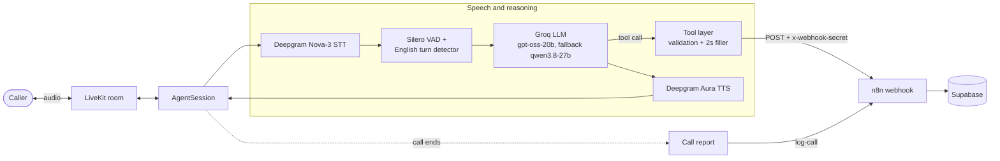

# Clinic Voice Agent

Tina is an English-speaking AI receptionist for **Rahim** clinic. She checks
doctor availability, books, reschedules and cancels appointments, answers clinic
questions, and takes callback requests over a LiveKit voice call.

The agent talks only to n8n. It never connects to Supabase directly and holds no
Supabase credentials.

## Architecture



### Components

| Layer | Implementation | Responsibility |
| --- | --- | --- |
| Transport | LiveKit room and worker | Carries call audio and hosts the agent job |
| Speech input | Deepgram Nova-3 | English speech-to-text |
| Turn handling | Silero VAD + `EnglishModel` | Endpointing and turn detection |
| Reasoning | Groq `openai/gpt-oss-20b` | Tool calling and spoken replies |
| Fallback | Groq `qwen/qwen3.8-27b` | Separate rate-limit bucket when the primary is busy |
| Speech output | Deepgram Aura `aura-2-thalia-en` | English text-to-speech |
| Tools | `tools.py` | Validation, caller phone resolution, filler, n8n HTTP calls |
| Automation | n8n webhook | Appointment and clinic logic |
| Storage | Supabase | Managed by n8n, never accessed by the agent |

### Call flow

1. The caller joins a LiveKit room through SIP or the Agents Playground.
2. Tina greets the caller and listens through Deepgram Nova-3.
3. The LLM decides whether to reply or call a tool.
4. A tool speaks a short filler, pauses for two seconds, then POSTs to n8n.
5. n8n performs the appointment operation and returns JSON.
6. Deepgram Aura speaks the reply.
7. When the call ends, the agent sends a best-effort `log-call` request.

## Quick start

Requirements: Python 3.10+, a LiveKit project, Deepgram, Groq, and an active n8n
webhook.

```bash
cd clinic-voice-agent
python3 -m venv .venv
source .venv/bin/activate
python -m pip install -r requirements.txt
cp .env.example .env
```

Fill in `.env`, then download the local models once:

```bash
python main.py download-files
```

Run locally with a microphone and speaker:

```bash
python main.py console
```

Or connect the worker to the LiveKit Agents Playground:

```bash
python main.py dev
```

For production, run `python main.py start` under a process manager or deploy it
as a LiveKit worker.

## Configuration

`config.py` loads `.env` once and validates required values at startup.

| Variable | Required | Default | Purpose |
| --- | --- | --- | --- |
| `LIVEKIT_URL` | Yes | - | LiveKit WebSocket URL |
| `LIVEKIT_API_KEY` | Yes | - | LiveKit API key |
| `LIVEKIT_API_SECRET` | Yes | - | LiveKit API secret |
| `DEEPGRAM_API_KEY` | Yes | - | Nova-3 STT and Aura TTS |
| `GROQ_API_KEY` | Yes | - | Primary and fallback LLM |
| `N8N_WEBHOOK_URL` | Yes | - | Exact production webhook URL, no trailing slash |
| `N8N_WEBHOOK_SECRET` | Yes | - | Sent as the `x-webhook-secret` header |
| `GROQ_MODEL` | No | `openai/gpt-oss-20b` | Primary Groq model |
| `GROQ_FALLBACK_MODEL` | No | `qwen/qwen3.8-27b` | Fallback Groq model |
| `TTS_MODEL` | No | `aura-2-thalia-en` | Deepgram Aura voice |
| `TEST_PHONE` | No | - | Caller ID fallback for browser tests |
| `WEBHOOK_TIMEOUT_SEC` | No | `8` | Total n8n request timeout |

`.env` is gitignored. Never commit real keys or webhook secrets.

## Webhook contract

Every request is sent to the exact `N8N_WEBHOOK_URL` with:

```http
POST {N8N_WEBHOOK_URL}
Content-Type: application/json
x-webhook-secret: {N8N_WEBHOOK_SECRET}
```

The JSON body always includes an `action` field. n8n must return HTTP 200 with a
JSON object. Application failures such as `slot_taken` should still use HTTP 200
with `"success": false`; non-200 responses are treated as `system_error`.

| `action` | Request fields | Success response |
| --- | --- | --- |
| `check-availability` | `date` (`YYYY-MM-DD`), optional `doctor_name` | `{"success": true, "slots": ["ISO-8601", ...]}` |
| `book-appointment` | `patient_name`, `phone`, `doctor_name`, `starts_at`, `reason`, optional `email` | `{"success": true, "appointment_id": "...", "doctor": "...", "starts_at": "..."}` |
| `cancel-appointment` | `phone`, `date` | `{"success": true}` |
| `reschedule-appointment` | `phone`, `old_date`, `new_starts_at` | `{"success": true, "starts_at": "..."}` |
| `clinic-info` | `key`: `timings`, `address`, `fee`, `emergency`, or `closed_days` | `{"success": true, "value": "..."}` |
| `request-callback` | `phone`, `reason` | `{"success": true}` |
| `log-call` | `caller_phone`, `duration_sec`, `outcome`, `transcript` | `{"success": true}` |

Expected failure values include `doctor_not_found`, `slot_taken`, `not_found`,
`missing_fields`, `invalid_input`, and `system_error`. The agent converts
timeouts, connection errors, 401s, other non-200s, and invalid JSON into
`system_error`.

## n8n workflow

A sanitized workflow export is included at
[`n8n/clinic-agent.workflow.json`](n8n/clinic-agent.workflow.json). It contains no
credentials, Supabase project refs, webhook secrets, or pinned execution data.

See [`n8n/README.md`](n8n/README.md) for import steps, required Supabase objects,
and credential setup. The export currently implements `check-availability` and
`book-appointment`; add branches for the other actions listed above before
relying on cancel, reschedule, clinic-info, callback, or call logging in
production.

## Local testing

### Voice samples

```bash
python test_voices.py --dry-run
python test_voices.py
```

Audio is written to `voice_tests/`. Use `--model` to try another Aura voice.

### Mock n8n

`mock_n8n.py` implements the same single-endpoint contract on port `5678`:

```bash
python mock_n8n.py
```

Set the agent to use the mock:

```env
N8N_WEBHOOK_URL=http://127.0.0.1:5678/webhook
N8N_WEBHOOK_SECRET=dev-secret
```

Keep the same secret in both processes. The mock returns three slots for
tomorrow (09:00, 10:00, 11:00); booking or rescheduling a 10:xx slot returns
`slot_taken` so the recovery path can be tested. If `N8N_WEBHOOK_SECRET` is
unset, the mock uses `dev-secret`.

### Syntax check

```bash
python -m py_compile main.py prompts.py tools.py config.py mock_n8n.py
```

## Project layout

```text
clinic-voice-agent/
|-- main.py            # Worker, AgentSession, LLM fallback, call report
|-- prompts.py         # Tina/Rahim prompt, greeting, doctor list
|-- tools.py           # Tool validation, filler, n8n webhook calls
|-- config.py          # .env loading and typed settings
|-- mock_n8n.py        # Local webhook mock for development
|-- test_voices.py     # Deepgram Aura voice samples
|-- n8n/
|   |-- clinic-agent.workflow.json
|   `-- README.md
|-- requirements.txt
|-- .env.example
`-- README.md
```

## Troubleshooting

| Symptom | Check |
| --- | --- |
| `401` from n8n | `N8N_WEBHOOK_SECRET` must match the n8n webhook credential |
| n8n timeout | URL reachable, workflow active, and `WEBHOOK_TIMEOUT_SEC` suitable |
| Groq `429` | Free tier is 8K TPM per model; the fallback has its own bucket. For sustained volume, upgrade to Groq's Developer tier |
| Groq `404` model not found | List models with `curl https://api.groq.com/openai/v1/models -H "Authorization: Bearer $GROQ_API_KEY"` and update `GROQ_MODEL` / `GROQ_FALLBACK_MODEL` |
| Deepgram `401` | `DEEPGRAM_API_KEY` needs STT and TTS access |
| Deepgram voice not found | Set `TTS_MODEL` to an available Aura voice |
| Turn detector error | Run `python main.py download-files` again |
| Caller is `unknown` | Browser calls have no SIP ID; set `TEST_PHONE` |
| Mock port in use | Stop the other process using port `5678` |

## Design notes and limitations

- **English only.** The prompt and Deepgram models are configured for English.
  If a caller uses another language, Tina says she can only continue in English.
- **AI disclosure.** Tina identifies herself as the clinic's virtual assistant
  and never claims to be human.
- **Rate-limit tuning.** Speculative generation is disabled, replies are capped
  at 200 completion tokens, and history keeps the last 24 items. If the primary
  Groq model fails, the session sticks to the fallback model until it also fails.
- **No direct patient database access.** Reschedule and cancel identify the
  appointment by caller phone plus date. The agent does not look up full patient
  records or appointment IDs itself.
- **Phone handling.** The caller's SIP number is used first, then `TEST_PHONE`,
  then `unknown`. Pakistani formats such as `0300...`, `92300...`, `+92300...`
  and `00923...` are normalized to `+92...`.
- **Time zone.** All date and time handling uses `Asia/Karachi` (UTC+5, no DST).
- **Call logging is best effort.** It never raises, waits at most five seconds,
  and is skipped during worker shutdown.
- **LiveKit version.** The project pins `livekit-agents~=1.8.8`. The current
  English text turn detector is retained for 1.x; a future 2.x upgrade should
  move to the audio turn detector.
