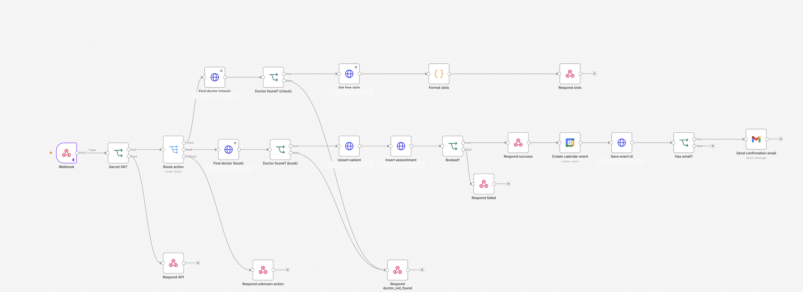

# n8n workflow

`clinic-agent.workflow.json` is a sanitized export of the n8n workflow behind the
voice agent. It contains no credentials, project references, instance IDs,
pinned execution data, webhook secrets, or calendar email addresses.

The endpoint captions in this preview are redacted; the workflow JSON is the
source of truth.

## Import

1. In n8n, open **Workflows → Import from file** and select
   `clinic-agent.workflow.json`.
2. Set the n8n environment variable `CLINIC_WEBHOOK_SECRET` to the same value as
   the agent's `N8N_WEBHOOK_SECRET`.
3. Replace every `YOUR_PROJECT_REF` placeholder with your Supabase project ref.
4. Attach your own Supabase credential to the HTTP Request nodes.
5. Attach your Google Calendar and Gmail credentials, then select the target
   calendar (the export uses `primary`).
6. Activate the workflow and copy its production URL into the agent's
   `N8N_WEBHOOK_URL`.

If your n8n instance blocks `$env`, replace the expression in **Secret OK?** with
the same secret locally. Do not export or commit that value.

## Required Supabase objects

The workflow expects these tables and RPC:

- `doctors`: `id`, `full_name`, `slot_minutes`, `is_active`
- `patients`: `full_name`, `phone` (unique), `email`
- `appointments`: `doctor_id`, `patient_id`, `starts_at`, `ends_at`, `reason`,
  `calendar_event_id`
- `get_available_slots(p_doctor, p_date)`: returns rows with `slot_start`

## Current coverage

The exported workflow implements:

- `check-availability`
- `book-appointment` (patient upsert, appointment insert, calendar event, email)

The agent also exposes `cancel-appointment`, `reschedule-appointment`,
`clinic-info`, `request-callback`, and `log-call`. Add matching branches to the
**Route action** switch before relying on those tools in production; otherwise
they receive `unknown_action`.

## Security notes

- The webhook validates `x-webhook-secret` before routing any action.
- Keep the secret only in n8n environment variables and the agent's `.env`.
- Use a strong random secret in production; `dev-secret` is only for local runs.
- Credentials are intentionally omitted and must be reattached after import.
- Do not commit exported workflows that contain credentials or pinned execution
  data.
